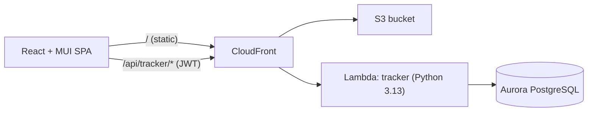

# Project Tracker

A project management tool for tracking projects, milestones, budgets and the
hours people spend on them. It has three roles: **admin**, **manager** and
**employee**. Nothing is ever deleted. Removed items move to an archive that
only admins can see, and admins can restore anything from there.

Built on the workshop stack: **React + Material UI** frontend, **Python AWS
Lambda** backend, **PostgreSQL** (Aurora in AWS), deployed with **Terraform**
to S3 + CloudFront + Lambda + RDS.

> The original workshop instructions now live in [docs/WORKSHOP.md](./docs/WORKSHOP.md)
> and [docs/README.md](./docs/README.md).

---

## What each role can do

| Capability | Admin | Manager | Employee |
| --- | :---: | :---: | :---: |
| Create projects and assign a manager | ✅ | — | — |
| Edit project details, dates, budget, status | ✅ all | ✅ own projects | — |
| Reassign a project's manager | ✅ | — | — |
| Mark projects / milestones completed | ✅ | ✅ own projects | — |
| Archive a (completed) project | ✅ | — | — |
| Create, edit, complete, archive milestones | ✅ | ✅ own projects | — |
| Assign employees to a project (any team) | ✅ | ✅ own projects | — |
| Log time | ✅ for anyone | ✅ for people on own projects | ✅ own time, assigned projects only |
| See projects | all | the ones they manage | the ones they're assigned to |
| Add people, change roles, move people between teams | ✅ | — | — |
| Edit a person's name and email | ✅ anyone | ✅ direct reports only | — |
| See and restore the Archive | ✅ | — | — |

Rules from the requirements, and where they're enforced (`backend/tracker/app/permissions.py` + routes):

- **One manager per project**, many employees per project, many projects per employee.
- **One manager per employee.** Managers can bring someone from another team onto
  their project (the stretch goal). That person stays on their own team, because only an admin can move someone between teams.
- **Milestones** have their own start/end dates, budget, status and members (one milestone, many employees). Members must already be on the project.
- **8-hour days.** Planned capacity is `weekdays(start → estimated end) × 8 h × people`.
  Time totals are shown in hours and in 8-hour days.
- **Budgets.** Managers can adjust a project's budget, but not below what is already
  allocated to milestones. The milestone budgets on a project can't add up to more than the project's budget.
- **Completion.** A project can be marked complete only when all its milestones are
  complete. Only completed projects can be archived, and only by an admin.
- **Nothing is deleted.** Every `DELETE` sets `archived_at`/`archived_by`. Unassigning
  someone sets `removed_at` and keeps their logged hours. Archived records are visible only to admins.

### Assumptions (call out if any are wrong)

- "8 hours per day" means **weekdays only** (Mon–Fri). Holidays are not modeled.
- Time can't be logged in the future or before the project start, and one person can't log more than 24 h on a single day.
- An employee may exist without a manager until an admin assigns one (shown in red on People).
- The project's *estimated* end date can be passed. The project then shows as **Overdue** instead of blocking work.

---

## Architecture



- **One Lambda (`backend/tracker`), split into modules.** Terraform deploys every folder under
  `backend/` as its own Lambda and packages only that folder. Splitting into
  several Lambdas would have meant copying the shared auth/DB/permission code into
  each one. Instead, a small router dispatches to one module per domain under
  `app/routes/` (`auth`, `users`, `projects`, `milestones`, `time_entries`, `archive`, `dashboard`).
- **Per-request transaction.** Each request runs in one DB transaction, so a failed
  operation never leaves partial writes.
- **Schema on cold start.** `CREATE TABLE IF NOT EXISTS` runs under an advisory lock,
  and the first boot seeds an admin plus demo data (`SEED_DEMO_DATA=false` to skip).
- **Auth.** PBKDF2-SHA256 password hashes (standard library, so there's no native build for Lambda).
  HS256 JWTs: a 60-minute access token plus a 7-day refresh token. The frontend refreshes
  automatically on a 401. The signing secret is `JWT_SECRET` if set; otherwise it's derived from the
  per-deployment random DB password, so no infrastructure changes are needed.
- **Consistent errors.** Every error is `{"error": {"code", "message", "details?"}}` with
  400/401/403/404/409/500 status codes. `details` maps field names to messages, which the
  forms show next to each field.

```
backend/
  tracker/               # the Lambda (auto-discovered by Terraform)
    function.py          # entry point: auth, transaction, error mapping
    app/
      config.py db.py schema.py security.py http.py router.py
      permissions.py     # every RBAC rule in one place
      validation.py metrics.py errors.py
      routes/            # auth, users, projects, milestones, time_entries, archive, dashboard
  tests/                 # pytest: unit + integration against real Postgres
  local_server.py        # optional: run the API without LocalStack
frontend/
  src/
    services/            # api client (token refresh), auth + toast contexts
    hooks/               # useApi, useForm, useDebounce
    components/          # AppShell, CapacityBar, MilestoneTimeline, dialogs in forms/
    pages/               # Dashboard, Projects, ProjectDetail, Time, People, Archive, Login
    __tests__/           # Vitest + Testing Library
  e2e/                   # Playwright critical-path tests
```

### Data model

`users` (role, `manager_id` → users) · `projects` (`manager_id`, dates, budget, status) ·
`project_members` · `milestones` (`project_id`, dates, budget, status) ·
`milestone_members` · `time_entries` (`project_id`, optional `milestone_id`, `user_id`,
`work_date`, `hours`). The main tables have `archived_at`/`archived_by`, and the link tables have `removed_at`.

---

## Running locally

### Option A: the workshop way (LocalStack)

```sh
source ~/.bashrc
./bin/start-dev.sh          # Postgres, LocalStack, deploys the tracker Lambda, Vite on :3000
```

Open http://localhost:3000. The CORS proxy on `:3001` forwards `/api/tracker/*` to the
Lambda. It now forwards the `Authorization` header too (a one-line change in `bin/proxy-server.js`).

### Option B: quick loop without Docker

```sh
pip install -r backend/tests/requirements-dev.txt
POSTGRES_HOST=localhost POSTGRES_USER=postgres POSTGRES_PASS=postgres123 POSTGRES_NAME=postgres \
  python3 backend/local_server.py            # API on http://localhost:3001/api/tracker
cd frontend && npm install && npm run dev    # UI on http://localhost:3000
```

### Demo accounts (seeded on first start)

| Role | Username | Password |
| --- | --- | --- |
| Admin | `admin` | `Admin123!` |
| Manager | `mlopez` (also `dchen`) | `Manager123!` |
| Employee | `apatel` (also `jsmith`, `lnovak`, `sokafor`) | `Employee123!` |

Change the admin password after the first sign-in (user menu → Change password). You can also set
`SEED_ADMIN_PASSWORD` before the first deploy.

---

## Deploying to AWS

```sh
source ~/.bashrc
./bin/deploy-backend.sh     # Terraform: Lambda (tracker), Aurora, CloudFront, S3
./bin/deploy-frontend.sh    # builds with VITE_API_URL=<CloudFront URL> and syncs to S3
```

The app is then served from the CloudFront URL printed by Terraform (`website_url`).
API calls go to the same origin under `/api/tracker/*`. The first request creates the
schema and seed data.

To tail logs: `aws logs tail /aws/lambda/coding-workshop-tracker-<id> --follow`. Each
request logs one JSON line with method, path, status and duration.

---

## Testing

| Suite | Command | Result |
| --- | --- | --- |
| Backend unit + integration (real Postgres) | `cd backend && pytest --cov=tracker` | **77 passed, 90% coverage** |
| Backend security scan (CI) | `bandit -r ./backend` | **No issues** |
| Frontend unit + component | `cd frontend && npm test` / `npm run coverage` | **42 passed, 82% lines** |
| Frontend lint / audit (CI) | `npm run lint` / `npm audit --audit-level=high` | **Clean / 0 vulnerabilities** |
| End-to-end (Playwright) | app running, then `cd frontend && npm run e2e` | **3 passed** |

- Integration tests need Postgres and create their own `tracker_test` database. Point
  them at a server with `TEST_POSTGRES_HOST/PORT/USER/PASS` (defaults: localhost:5432, postgres/postgres123).
- The E2E run covers the full lifecycle: admin creates a project → manager staffs it
  (own team plus someone from another team) and adds a milestone → employee logs a day → manager
  completes the milestone and project → admin archives and restores it. It also covers role-based
  navigation and a failed login.
  Set `E2E_BASE_URL` to run it against the deployed CloudFront URL.

**Known gaps:** no load tests (Artillery/JMeter) yet. Frontend function coverage is
68%, mostly in rarely used dialog branches.

---

## API reference

All paths are under `/api/tracker`. Every endpoint except `auth/login`, `auth/refresh` and `health` needs `Authorization: Bearer <token>`.

| Method | Path | Who | Notes |
| --- | --- | --- | --- |
| POST | `/auth/login` | public | `{username or email, password}` → tokens + user |
| POST | `/auth/refresh` | public | `{refresh_token}` → new tokens |
| GET | `/auth/me` | all | current profile |
| POST | `/auth/change-password` | all | `{current_password, new_password}` |
| GET | `/dashboard` | all | role-scoped stats, projects, upcoming milestones, weekly hours |
| GET / POST | `/users` | all / admin | filters: `role`, `search`, `manager_id` |
| GET / PUT / DELETE | `/users/{id}` | scoped / admin, manager (name+email of reports) / admin | DELETE archives |
| GET / POST | `/projects` | scoped / admin | filters: `status`, `search`, `manager_id` |
| GET / PUT / DELETE | `/projects/{id}` | scoped / admin, manager / admin | DELETE archives (completed only) |
| GET / POST | `/projects/{id}/members` | scoped / admin, manager | `{user_ids: [...]}` |
| DELETE | `/projects/{id}/members/{userId}` | admin, manager | unassign (hours kept) |
| GET / POST | `/projects/{id}/milestones` | scoped / admin, manager | `user_ids` sets members |
| GET / PUT / DELETE | `/milestones/{id}` | scoped / admin, manager | DELETE archives |
| GET / POST | `/time-entries` | scoped | filters: `project_id`, `user_id`, `milestone_id`, `from`, `to`; returns totals |
| PUT / DELETE | `/time-entries/{id}` | owner, project manager, admin | DELETE archives |
| GET | `/projects/{id}/time-entries` | scoped | same shape as `/time-entries` |
| GET | `/archive` | admin | archived users, projects, milestones, time |
| POST | `/archive/{users\|projects\|milestones\|time-entries}/{id}/restore` | admin | restore |

---

## Trade-offs and next steps

- **Single Lambda instead of one per resource.** This keeps shared code in one place with no
  duplication, and still deploys through the unmodified workshop Terraform. If the
  services needed to scale independently, the next step would be to split them and share the code through a Lambda layer.
- **Schema migrations** are idempotent DDL. A growing schema would need a versioned
  migration tool (e.g. Alembic or yoyo).
- **Tokens in `localStorage`** keep the static S3 hosting simple. An httpOnly-cookie
  setup would need an API on the same domain plus CSRF handling.
- Ideas for later: CSV export of timesheets, email reminders for overdue milestones,
  holiday calendars for capacity, and a per-week timesheet entry grid.
